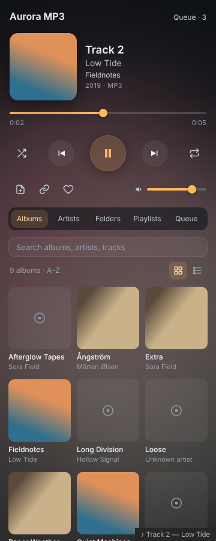

# Aurora MP3

Play music from folders on your computer in an Obsidian sidebar player, with album covers, playlists, a queue, resume and daily note logging.



## Features

- **Your own music:** point it at one or more folders, such as your Music folder. It scans subfolders and reads MP3, FLAC, M4A/AAC, Ogg, Opus and WAV.
- **Tags and covers:** reads titles, artists, albums, track numbers and embedded covers (ID3, FLAC, MP4 and Vorbis tags). If a file has no embedded cover, it uses a `cover.jpg` or `folder.jpg` from the album's folder.
- **Browse:** albums (as a grid or a list), artists, folders, playlists and the queue, plus search across everything.
- **Play:** a queue with shuffle and repeat (off, all or one), favourites and playlists. Right-click any track, album, artist or folder for **Play next**, **Add to queue** or **Add to playlist**.
- **Resume:** after a restart, the last track is waiting where you left it. Long tracks (over 8 minutes, such as mixes) remember their own position.
- **Notes:**
  - **Listening log** adds a line such as `- 14:32 ♪ Title — Artist (Album)` to your daily note or to a note of your choice, either when you press the button or automatically for every track you listen to. You can also turn it off. The line format is set in settings.
  - **Add to note** puts a small player card (with a Play button) for the track, album, artist, folder or playlist into the note you're editing.
- **Two looks:**
  - **Glass:** large covers and soft glows tinted by the album art.
  - **Terminal:** calm monospace text.
- **Static Aurora theme:** with the [Static Aurora](https://github.com/AshOtis/aurora-theme) theme installed, the theme's glows take on the colours of the album cover when you press play. They stay when you pause. Turn this off in settings with **Colour the Static Aurora theme**.
- **Spotify and other apps (Windows):** turn on **Show what's playing on your computer** and, when Spotify, a browser, Apple Music, VLC or another app is playing, Aurora MP3 shows the track and its cover with play/pause, next and previous. Its album colours tint the player and the Static Aurora theme, even while the player is hidden. Press **Resume** or play your own music and Aurora MP3 takes over again. No Spotify account or setup: the track is read from Windows, the same place the volume pop-up gets it. It works without a music folder too.
- **Takes turns:** pressing play pauses my other players (Static FM, Hi-Fi Tuner), and they pause Aurora MP3. Turn on **Play alongside other players** to mix them.
- Media keys, now-playing in the status bar, and commands for everything. Set your own hotkeys in **Settings → Hotkeys**.

## Getting started

1. Open **Settings → Aurora MP3** and paste the path of your music folder, for example `C:\Users\you\Music`. Then click **Add**.
2. Click the disc icon in the left ribbon, or run **Aurora MP3: Open player**.

The first scan reads every file once. After that, rescans skip unchanged files and are quick.

## Embeds

````
```aurora-mp3
album: Fieldnotes
artist: Low Tide
```
````

Also works with `track: <file path>`, `artist: <name>`, `playlist: <name>` and `folder: <path>`.

## Permissions and privacy

The plugin directory flags file system access. Here is what it means:

- **File system access (Node.js `fs`):** this is needed to play music stored outside your vault. Aurora MP3 uses it **read-only**. It lists the music folders you add in settings and reads the audio files in them (tags, covers and playback), plus a `cover.jpg` or `folder.jpg` beside them. It never writes, moves or deletes anything outside your vault. Its own files (`library.json`, `covers/` and `data.json`) are written through Obsidian's normal vault API, in the plugin's folder.

- **Running a Windows command (Node.js `child_process`), only if you turn on "Show what's playing on your computer":** Aurora MP3 starts a small hidden Windows PowerShell process that asks Windows' media controls what is playing (title, artist, album and cover) about once a second, and sends play/pause, next and previous when you press those buttons. It runs only while the setting is on and stops when you turn it off or close Obsidian. It reads nothing else, and the information stays on your computer. The full script is in [`src/nowplaying.js`](src/nowplaying.js).

It doesn't use the clipboard, makes no network requests and has no telemetry. Nothing leaves your computer.

## Desktop only

Reading folders outside the vault needs the desktop app.

## Building from source

There are no dependencies. Run `python3 build.py` to write `main.js`, `styles.css` and `manifest.json` to `dist/`. The tag reader is written from scratch in `src/tags.js`.

## Support

If you enjoy it, you can [buy me a coffee](https://buymeacoffee.com/ashotis). Found a bug or have an idea? [Open an issue](https://github.com/AshOtis/aurora-mp3/issues). It's the best way to reach me, and every report gets read.

## License

<<<<<<< HEAD
[GNU AGPL v3 or later](LICENSE) © AshOtis
=======
[GNU AGPL v3 or later](LICENSE)  © AshOtis: free for personal and other noncommercial use; selling it or using it commercially needs my permission. Versions before this change were released under MIT.
>>>>>>> 5ff5e8b78f9676a241379d63b98dfb528f571326
